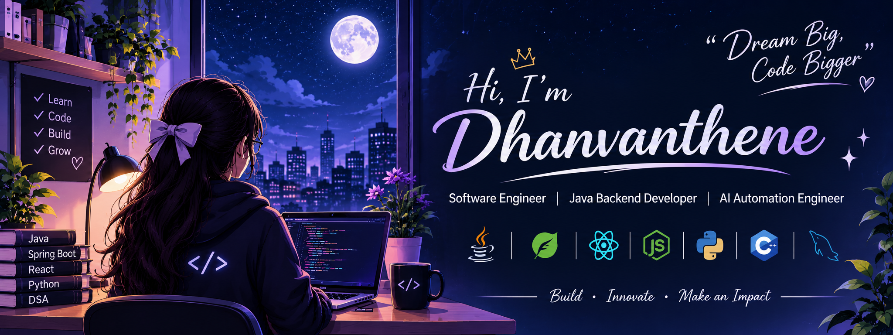

  

---

## 👨‍💻 About Me

- 🎓 B.E. Electronics and Communication Engineering graduate (2026).
- 💻 Interested in Software Engineering and Full Stack Development.
- ☕ Building backend applications using Java and Spring Boot.
- 🌐 Developing frontend applications using React.js.
- 🤖 Exploring AI-powered applications and automation.
- 🧠 Improving Data Structures, Algorithms and Problem Solving.
- 🚀 Passionate about building meaningful software products.

---

## 🛠️ Tech Stack

### Programming Languages

  

### Backend Development

  

### Frontend Development

  

### Databases

  

### Tools & Technologies

  

---

<h2>🚀 Featured Projects</h2>

<table>
<tr>
<td width="50%" align="center">

<h3>🏥 XCare</h3>

Production-Grade Conversational AI Platform for Health Risk Triage and Decision Support.

<b>Features</b>

✔ AI-Powered Symptom Analysis 
✔ Health Risk Assessment 
✔ Conversational AI Interface 
✔ REST API Integration

<b>Tech</b>

<code>React</code>
<code>FastAPI</code>
<code>Python</code>
<code>Docker</code>

</td>

<td width="50%" align="center">

<h3>🎓 Student Management System</h3>

Web-based application for managing student information and academic records.

<b>Features</b>

✔ Student Registration 
✔ Student Record Management 
✔ CRUD Operations 
✔ MySQL Database Integration

<b>Tech</b>

<code>Python</code>
<code>Flask</code>
<code>MySQL</code>
<code>Bootstrap</code>

</td>
</tr>
</table>

## 📊 GitHub Statistics

  
  

---

## 🔥 Contribution Streak

  

---

## 📈 Contribution Graph

  

---

<h2>🌐 Connect With Me</h2>

  
  
  

---

  ✨ Building reliable software solutions using Code + AI ✨

